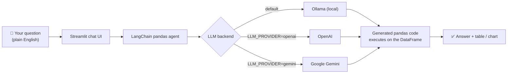

# 💬 Chat With Your Data

**Ask questions in plain English, get answers from your CSV — an LLM agent that writes and runs pandas code on your data.**

Upload any CSV, type a question like *"total revenue by region"*, and get the answer back as text, a table, or a chart — no SQL, no pandas needed. Runs **100% locally and free with Ollama**, or swaps to OpenAI / Gemini with one env var.

## ✨ Key features

- **Chat with your data in plain English** — ask anything; the agent turns it into pandas code, executes it, and answers.
- **Multiple LLM backends** — Ollama (default: local, free, private), OpenAI, and Google Gemini, switchable with one `LLM_PROVIDER` env var.
- **LangChain pandas agent** — the agent inspects your dataframe's schema and writes real pandas code, not templates.
- **Answers with charts** — ask *"plot monthly revenue"* and the agent writes matplotlib code; the PNG renders inline.
- **Upload your own CSV** — the sample dataset ships with the repo, but any CSV works; the agent is cached per file.
- **Instant quick charts** — the sidebar renders plotly histograms and top-N bar charts with zero LLM calls.

## 🏗️ Architecture



The agent reads the dataframe's column names and dtypes, writes pandas code to answer your question, executes it in a sandboxed REPL, and returns the result. `temperature=0` keeps answers deterministic.

## 🛠️ Tech stack

| Layer | Tech |
|---|---|
| UI | Streamlit |
| Agent | LangChain `create_pandas_dataframe_agent` |
| LLMs | Ollama (local) · OpenAI · Google Gemini |
| Data | pandas |
| Charts | plotly (sidebar) · matplotlib (agent-generated) |
| Config | python-dotenv (`.env`) |

## 📋 Prerequisites

- Python 3.10+
- [Ollama](https://ollama.com) installed **and** a model pulled (for the free local backend):
  ```bash
  ollama pull llama3.1
  ```
- An OpenAI or Google API key **only** if you want to use those backends instead of Ollama.

## 🚀 Run it

```bash
# 1. Clone and enter the project
git clone <this-repo-url> && cd chat-with-your-data

# 2. Create a virtual environment
python -m venv .venv
source .venv/bin/activate        # Windows: .venv\Scripts\activate

# 3. Install dependencies
pip install -r requirements.txt

# 4. Configure (Ollama works with zero keys)
cp .env.example .env             # then edit .env if needed

# 5. Launch
streamlit run src/app.py
```

Open **http://localhost:8501**. The sample sales dataset loads automatically — upload your own CSV from the sidebar any time.

## ☁️ Deploy on Streamlit Cloud (free)

Ollama can't run in the cloud, so the deployed app uses Gemini (free tier key) — and it switches automatically:

1. Get a free key at [Google AI Studio](https://aistudio.google.com/apikey)
2. Sign in at [share.streamlit.io](https://share.streamlit.io) with GitHub → **New app**
3. Repo: `x10sic/chat-with-your-data`, branch `main`, main file path: `src/app.py`
4. **Advanced settings → Secrets** — paste the contents of [`.streamlit/secrets.toml.example`](.streamlit/secrets.toml.example) with your real `GOOGLE_API_KEY`
5. **Deploy**

How the fallback works: when `LLM_PROVIDER=ollama` (the default) and no Ollama server answers but a `GOOGLE_API_KEY` is set, the app uses Gemini instead — no config change needed. Set `LLM_PROVIDER=gemini` explicitly if you want to skip the probe. The sidebar always shows which backend is active. Free-tier caveat: the app sleeps after inactivity and takes ~30s to wake on the next visit.

## ⚙️ Environment variables

All settings live in `.env` (see `.env.example` — placeholders only, no keys committed):

| Variable | Default | What it does |
|---|---|---|
| `LLM_PROVIDER` | `ollama` | `ollama` · `openai` · `gemini` — when `ollama` is unreachable and `GOOGLE_API_KEY` is set, Gemini is used automatically |
| `OLLAMA_MODEL` | `llama3.1` | Model pulled via `ollama pull <model>` |
| `OLLAMA_BASE_URL` | `http://localhost:11434` | Ollama server address |
| `OPENAI_API_KEY` | *(empty)* | Your OpenAI key — required when `LLM_PROVIDER=openai` |
| `OPENAI_MODEL` | `gpt-4o-mini` | OpenAI chat model |
| `GOOGLE_API_KEY` | *(empty)* | Your Google AI key — required when `LLM_PROVIDER=gemini` |
| `GEMINI_MODEL` | `gemini-2.0-flash` | Gemini chat model |

## 📁 Project structure

```
chat-with-your-data/
├── src/
│   ├── app.py            # Streamlit chat UI + sidebar quick charts
│   ├── config.py         # env-based settings (defaults + .env)
│   ├── llm.py            # get_llm(): Ollama / OpenAI / Gemini
│   └── data_agent.py     # builds the LangChain pandas agent
├── data/
│   └── sample_sales.csv  # synthetic demo dataset (30 orders)
├── .env.example          # config template (no real keys)
├── .streamlit/
│   └── secrets.toml.example  # Streamlit Cloud secrets template
├── requirements.txt
└── README.md
```

## 🧪 Try these sample questions

On the bundled `sample_sales.csv` (30 orders, 7 columns: `order_id`, `date`, `region`, `product`, `category`, `quantity`, `unit_price`):

- `What is the total revenue by region?`
- `Which product sold the most units?`
- `Show me the top 3 regions by revenue as a table`
- `What is the average order value per month?`
- `Which category has the highest total quantity sold?`
- `Plot monthly revenue as a bar chart` ← agent writes matplotlib code, chart renders inline

## 📸 Screenshots

> TODO (Abhishek): add your screenshots here

## ⚠️ A note on safety

The agent runs with `allow_dangerous_code=True` — it must, because it executes the pandas code the LLM writes. Only ever point it at data you trust.

## 📝 Data note

The bundled `data/sample_sales.csv` is **fully synthetic sample data** (generic product names, fictional order IDs, no customer names, emails, or personal data). Uploaded CSVs land in `data/uploads/`, which is git-ignored.
